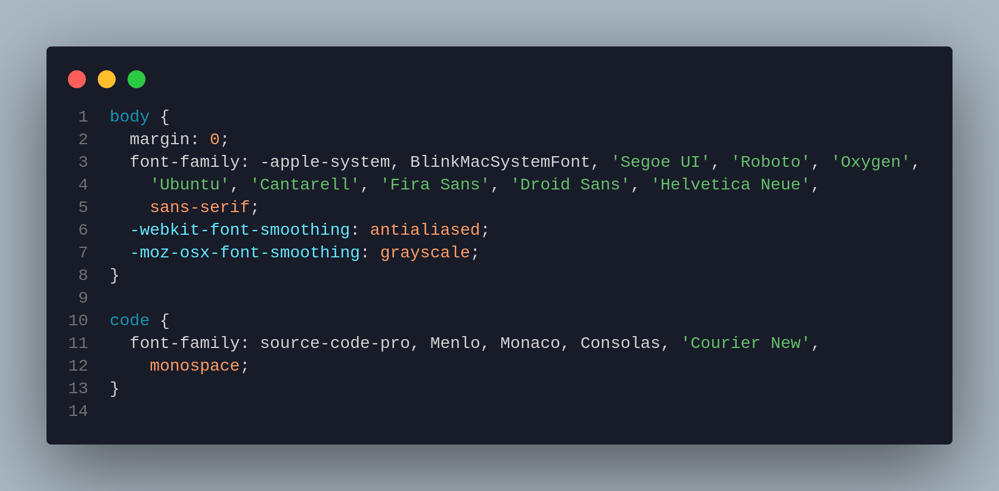
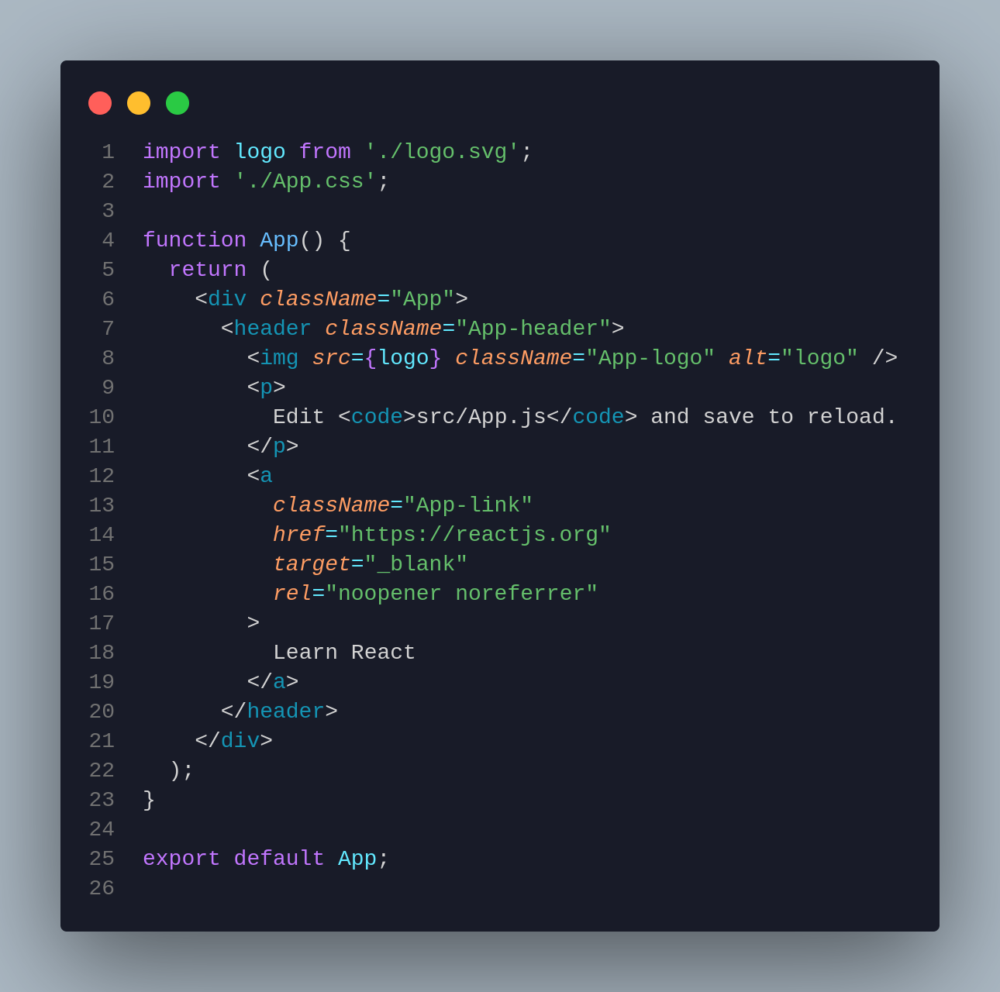
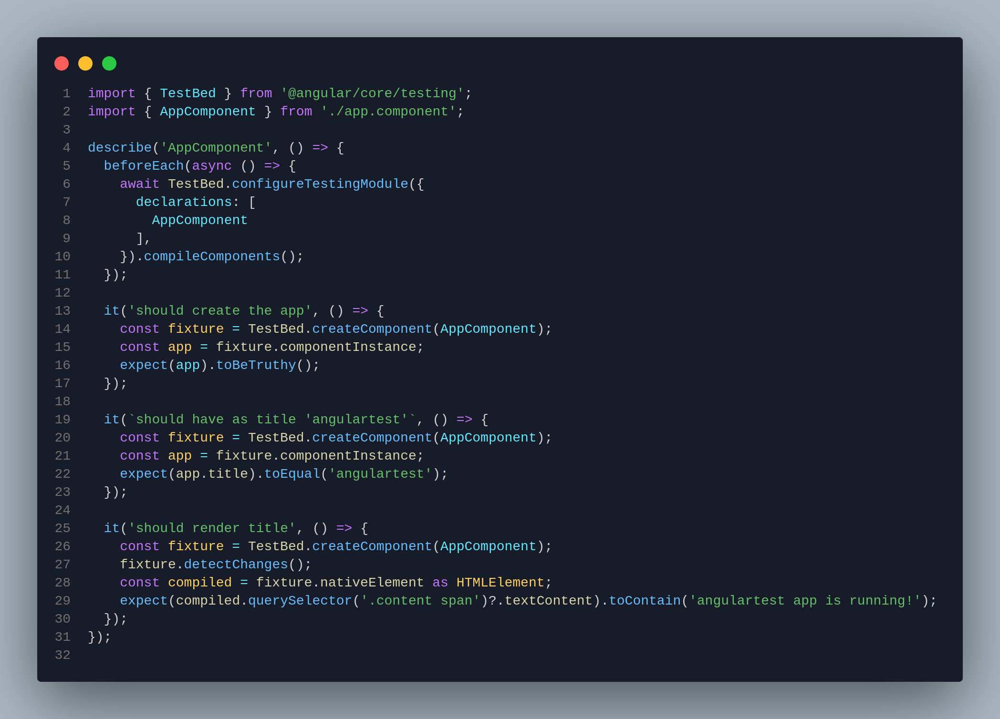

# lolo

Dark theme for Visual Studio Code. One extension, five choices. The original stays the original. The other four use the same scope rules with a different palette.

[Marketplace](https://marketplace.visualstudio.com/items?itemName=abhisofriendly.lolo-theme)

## Variants

| Theme | Palette |
| --- | --- |
| **lolo theme** | The original blue theme. This file is unchanged, so existing installs keep it. |
| **lolo 2026** | The same blue syntax, on a quieter modern workbench. |
| **lolo Tide** | Quiet ink surfaces, lavender text, mint strings, and pale blue functions. |
| **lolo Warm** | Sepia surfaces and a gold accent. |
| **lolo Violet** | Plum surfaces and a lilac accent. |

Open the Command Palette and run **Preferences: Color Theme**, then pick one of the five.

## Install

From VS Code, search the Extensions view for `lolo` by **abhisofriendly**.

From a terminal:

```bash
code --install-extension abhisofriendly.lolo-theme
```

## Syntax

Samples of the original **lolo theme** highlighting:







On **lolo theme** and **lolo 2026**, the accent is `#62e9ff`, types are `#c276ff`, and functions are `#ff9d63`. Tide, Warm, and Violet move those roles into their own palette.

## Develop

Open this folder in VS Code and press **F5**. In the Extension Development Host, choose **lolo theme** or **lolo 2026**. Reload that window with **Cmd+R** after a theme edit.

Package a Marketplace build:

```bash
npx @vscode/vsce package
```

The publisher id is `abhisofriendly` and the extension id is `lolo-theme`. A new `.vsix` updates the existing listing when the version is higher than the one already published.

## License

[MIT](LICENSE)
